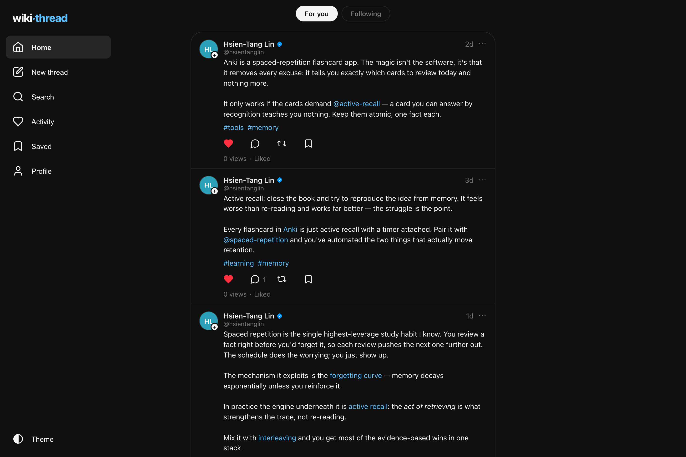
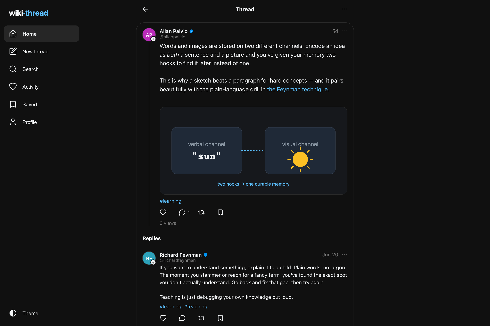
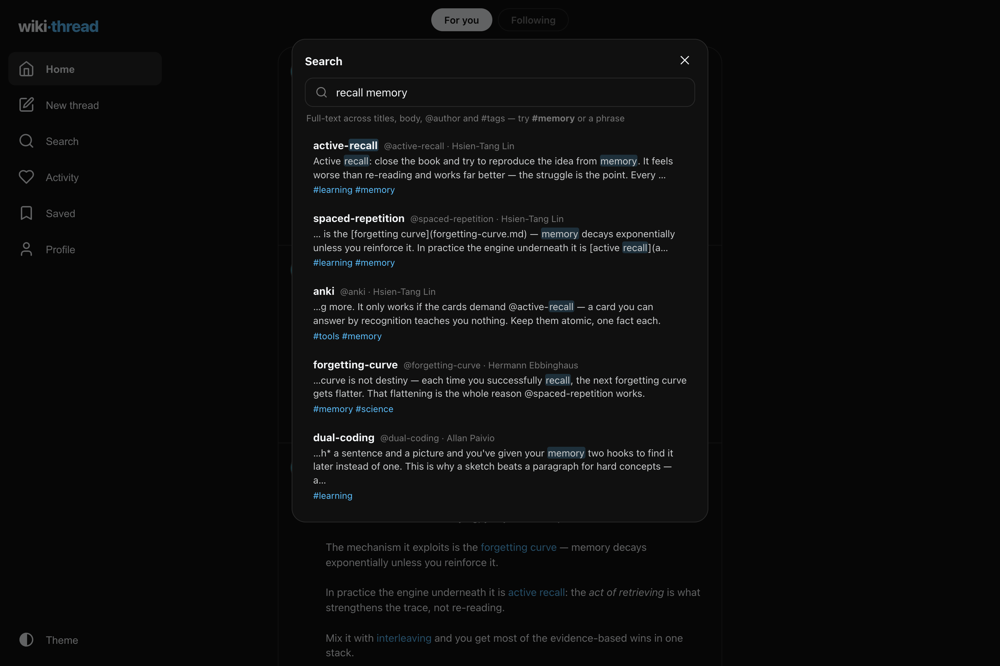
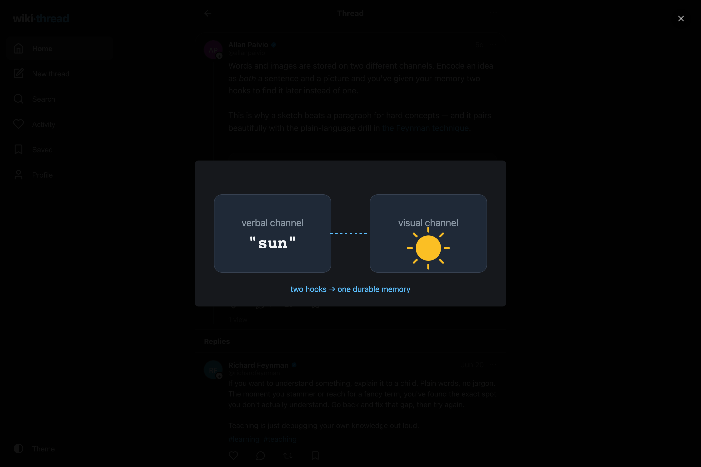
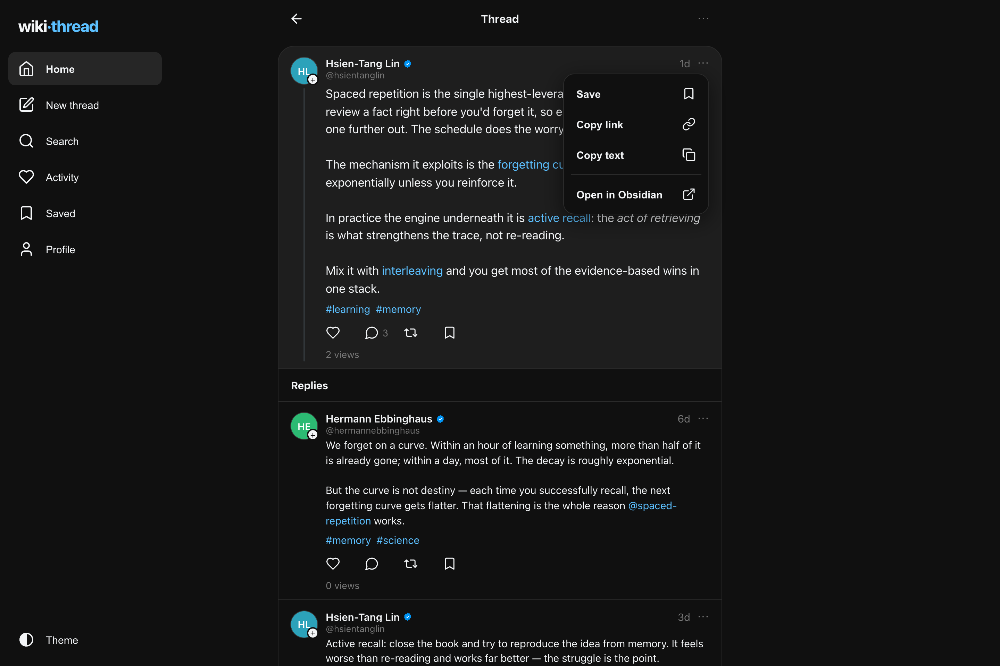

# wiki-thread

**Doomscroll your own Obsidian vault like it's Threads.** Point a tiny local server at a folder of
Markdown notes and browse them as an infinite, social-media-style feed — so reviewing your own
knowledge feels like the thing your brain already craves.

Each `.md` is a post. Links between notes become threaded replies. Liking, saving, reposting, and
replying all **write back into the actual `.md` files**, so your vault stays the single source of truth.

> The idea: studying your notes fails because notes are write-only. Reframe the vault as a feed and
> "review" turns into scrolling. Spaced-repetition by vibes.



[](LICENSE)


## Quick start

```bash
git clone https://github.com/<you>/wiki-thread.git
cd wiki-thread
node server.js            # serves the bundled sample vault on http://localhost:4173
```

No install, no build — the server uses **only Node built-ins**. Point it at your real vault:

```bash
node server.js ~/Obsidian/MyVault          # custom vault
node server.js ~/Obsidian/MyVault 8080     # custom vault + port
```

The only thing it adds to your vault is a gitignorable `.wiki-thread/` sidecar (view counts).
Everything else is plain Markdown edits you can see in Obsidian.

## Features

- 📜 **Infinite feed** of your notes — "For you" (relevance) and "Following" (newest).
- 🧵 **Threads** — a `[link](other.md)` or `[[wikilink]]` turns the linked note into a reply.
- ❤️ 🔖 🔁 💬 **Interactions write back to Markdown** — like→`#liked`, save→`#saved`, repost→`#reposted` + `reposts.md`, reply→new note in `replies/` linked into the parent.
- ✍️ **Compose** top-level notes (`posts/`) and replies, with `@`-mention autocomplete.
- 🔍 **Full-text search** over an inverted index — ranked by title/body/author/tags, with snippets, highlighting, and `#tag` filters.
- 🖼️ **Inline images** (`` served from the vault) with a **lightbox** (zoom + pan).
- 🔗 **Real URLs** — `/@author/post/<note>` and `/…/media`, with working browser back/forward and deep-link refresh.
- 🧭 **Threads-style UI** — labeled sidebar, Lucide icons, dim/light themes, `⋯` menu with **Open in Obsidian**.
- 🪶 **Zero runtime dependencies**, single ~700-line server, single HTML file.

| Thread + image | Full-text search |
|---|---|
|  |  |
| **Image lightbox** | **`⋯` post menu** |
|  |  |

## How notes map to the feed

| Vault | Feed |
|---|---|
| each `.md` file | a post (id = vault-relative path) |
| `[text](other.md)` / `[[other]]` | a threaded **reply** under it |
| `` | inline image (served from `/vault/…`) |
| `@slug` | a mention link to that note |
| frontmatter `author`, `time`, `title`, `tags` | name, timestamp, title, hashtags |
| inline `#tag` | hashtag |

Example note:

```markdown
---
author: Hermann Ebbinghaus
time: 2026-06-22T08:05:00
tags: [memory, science]
---
We forget on a curve. Each successful recall flattens the next one —
the whole reason @spaced-repetition works.
```

## How it works

```
Obsidian vault (.md)  ──read/write──►  server.js (in-memory index)  ──HTTP/JSON──►  browser (Threads UI)
```

- `server.js` parses frontmatter + body, builds an in-memory index and an inverted search index, and
  re-indexes on file changes. **"For you"** ranks by TF-IDF similarity to the centroid of your liked notes
  (plus tag-overlap and link-adjacency); cold start is recency.
- `public/index.html` is the whole frontend — vanilla JS, no framework, no bundler.

See [`CLAUDE.md`](CLAUDE.md) for the full architecture and extension guide.

## Testing

```bash
pnpm install      # only dev dep: @playwright/test
pnpm test         # 16-test Playwright smoke suite
```

Tests run against a throwaway copy of the vault, so your real notes are never touched.

## Contributing

Issues and PRs welcome. Keep the server **dependency-free** and the frontend **build-free** — that
simplicity is the point. New post actions / sidebar views / `⋯` items each have a one-paragraph recipe
in [`CLAUDE.md`](CLAUDE.md). Please add a Playwright test for behavior changes.

## License

[MIT](LICENSE) © Hsien-Tang Lin
