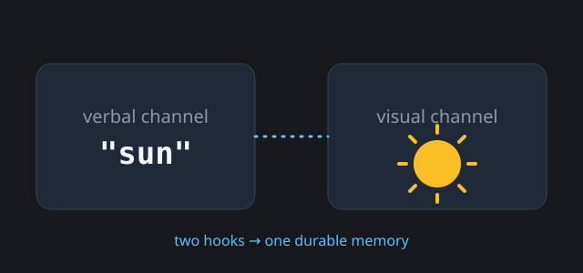

Words and images are stored on two different channels. Encode an idea as *both* a sentence and a picture and you've given your memory two hooks to find it later instead of one.

This is why a sketch beats a paragraph for hard concepts — and it pairs beautifully with the plain-language drill in [the Feynman technique](feynman-technique.md).

